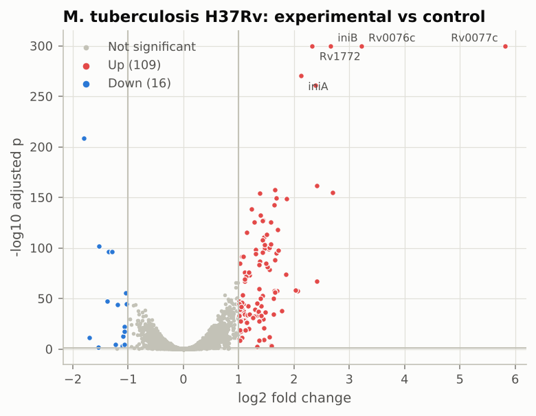
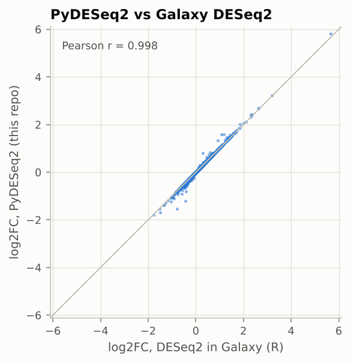
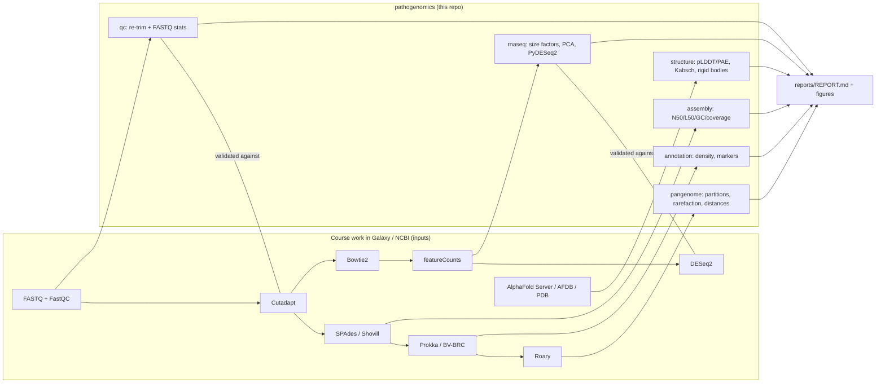

# BIOL 4640 · Pathogen Bioinformatics

[](https://github.com/lyu929/Pathogen-Bioinformatics/actions/workflows/ci.yml)


A reproducible, tested Python pipeline over my coursework for **BIOL 4640 – Fundamentals of
Bioinformatics** (Georgia State University, Fall 2025): read QC → genome assembly → annotation →
pangenome → RNA-seq differential expression → protein structure, across four bacterial
pathogens (*Mycobacterium abscessus*, *M. tuberculosis*, *Staphylococcus aureus*,
*Pseudomonas aeruginosa*) and the SARS-CoV-2 spike.

In the course every analysis was run point-and-click in [Galaxy](https://usegalaxy.org).
This repository takes the outputs I produced there and **re-derives every downstream
result in code**, then uses the Galaxy outputs as an independent reference to check that
the code is right.

## Highlights

| Check | Result |
| --- | --- |
| Cutadapt-compatible quality trimming (re-implemented) vs Galaxy Cutadapt 5.1 | **identical** on all 6 counts (5,190 reads, 17,416 bp trimmed, 387,289 bp kept) |
| FASTQ statistics vs FastQC 0.12.1 | identical read count and per-base mean quality (max diff 0) |
| DESeq2 median-of-ratios size factors vs PyDESeq2 / Galaxy normalised counts | identical (max rel. diff 6e-15) |
| PyDESeq2 vs Galaxy (R) DESeq2, *M. tuberculosis* | p-value rank r = 0.99995; **114/114** Galaxy DEGs recovered |
| PyDESeq2 vs Galaxy (R) DESeq2, *M. abscessus* | p-value rank r = 0.99996; **204/205** Galaxy DEGs recovered |
| MRSA screen on 7 *S. aureus* genomes | 5 `mecA`/PBP2a⁺; caught a **false positive** a symbol-only screen would make |
| Pangenome (Roary, 4 isolates + PA14) | 5,874 core / 64 accessory clusters; isolates far closer to each other than to PA14 |
| DosR homolog comparison (AlphaFold DB) | global RMSD 14.4 Å but two rigid domains at 0.61 / 0.46 Å → a hinge, not a fold change |

The full, auto-generated write-up with every table and figure is in
**[`reports/REPORT.md`](reports/REPORT.md)**.

<picture>
  <source media="(prefers-color-scheme: dark)" srcset="reports/figures/dark/rnaseq_mtb_volcano.png">
  
</picture>
<picture>
  <source media="(prefers-color-scheme: dark)" srcset="reports/figures/dark/rnaseq_mtb_concordance.png">
  
</picture>

## What the course covered and where it lives here

| Course unit (Fall 2025) | Data in this repo | Module |
| --- | --- | --- |
| Sequencing formats, QC, "is the data good or bad?" (Activities 3–4) | FastQC + Cutadapt reports for 6 libraries, raw BR-Tn1 reads | `qc` |
| Genome assembly (Activity 5, final Q42) | SPAdes contigs of 4 *P. aeruginosa* isolates; Shovill/SKESA outbreak assembly | `assembly` |
| Gene prediction & annotation (Activity 6, midterm) | BV-BRC annotation of the Activity 6 *S. aureus* genome; 6 RefSeq *S. aureus* genomes | `annotation` |
| Comparative genomics & pangenomes (final) | Roary gene presence/absence (Prokka-annotated isolates + PA14) | `pangenome` |
| RNA-seq I/II: alignment, counting, DE (Activities 9–10, final Q43) | featureCounts tables + Galaxy DESeq2 output (*M. abscessus*, *M. tuberculosis*) | `rnaseq` |
| Protein structure prediction (Activity 13, final) | AlphaFold 3 model of Mtb Zur (Rv2359); AlphaFold DB DosR homologs; PDB 6VXX / 9F9Y | `structure` |

## Pipeline



## Quick start

```bash
git clone https://github.com/lyu929/Pathogen-Bioinformatics.git
cd Pathogen-Bioinformatics
python -m venv .venv && source .venv/bin/activate
pip install -e ".[dev]"

pathogenomics run                 # ~40 s: writes results/*.tsv and reports/REPORT.md
pytest                            # 56 tests (add -m "not slow" to skip the two DESeq2 runs)
```

Individual tools are also exposed on the command line:

```bash
pathogenomics trim reads.fastq.gz -q 20 -m 22 -o trimmed.fastq.gz   # Cutadapt-compatible
pathogenomics fastq-stats reads.fastq.gz
pathogenomics assembly-stats contigs.fasta --min-length 500 --genome-size 6500000
pathogenomics pangenome gene_presence_absence.csv
```

## Findings

* **QC.** BR-Tn1 (5,190 reads, 78 bp) fails FastQC's per-base quality and adapter modules;
  Q20 trimming removes 4.3% of bases and only 7 reads. The *M. abscessus* RNA-seq libraries
  put 46–68% of assigned reads on the 23S rRNA gene, i.e. rRNA depletion was incomplete
  (the *M. tuberculosis* libraries: 2–7%).
* **Assembly.** The four *P. aeruginosa* SPAdes assemblies are 6.50 Mb in 57–66 contigs
  (N50 271–364 kb, GC 66.3%), inside the size range of complete *P. aeruginosa* genomes.
* **MRSA screening.** `mecA` (PBP2a) is present in MRSA107, M48, 0073_III_ST239, HU-14 and the
  Activity 6 genome, which also carries the PVL leukocidin genes. FDAARGOS_773 has a gene
  *symbol* `mecA` – but its product is the ClpC **adaptor protein MecA**, not PBP2a, so a
  symbol-based screen would wrongly call it MRSA. The screen therefore matches protein
  product text (`annotation.STAPH_MARKERS`), and the collision is a unit test.
* **Pangenome.** 98.9% of the 5,938 clusters are core; accessory-gene Jaccard distances among
  the clinical isolates (0.19–0.55) are much smaller than to PA14 (≥ 0.87).
* **RNA-seq.** *M. tuberculosis* experimental vs control: 109 up / 16 down; the strongest
  responses are Rv0077c/Rv0076c, the *iniBAC* operon, Rv1772/Rv1773c, Rv3161c and *hsp*.
  Galaxy's fold changes are slightly smaller in magnitude than PyDESeq2's maximum-likelihood
  estimates (median ratio 0.98 Mtb, 0.84 *M. abscessus*); most of the largest differences are among the 45 genes
  both tools flag as Cook's-distance outliers (p = NA), so the called gene sets barely change.
  PyDESeq2's independent filtering additionally drops 195 low-count *M. abscessus* genes from
  multiple-testing correction that the Galaxy run kept.
* **Structure.** The AlphaFold 3 Zur/FurB model is confident (mean pLDDT 88.8; ranking score
  0.81) apart from a disordered N-terminus. The *M. abscessus* LuxR-family regulator is 70%
  identical to Mtb DosR; whole-chain RMSD is 14.4 Å, yet the receiver domain (res. 1–133) and
  the DNA-binding domain (res. 144–211) each superpose at < 0.7 Å: the models differ by domain
  orientation. 6VXX vs 9F9Y recovers the Omicron-lineage RBD substitutions (G339D, S371F,
  S373P, S375F, K417T, N440K, N501Y, Y505H, …) plus D614G and the NTD deletion.

## Repository layout

```
config/course.toml        every input path and threshold used by `pathogenomics run`
data/                     course inputs (see data/README.md for provenance and licences)
src/pathogenomics/
  io/                     FASTA/FASTQ, GFF3, featureCounts, DESeq2, FastQC, Cutadapt readers
  qc.py assembly.py annotation.py pangenome.py rnaseq.py structure.py
  plotting.py report.py pipeline.py cli.py
tests/                    56 pytest tests (unit tests on synthetic data + checks on course data)
results/                  generated TSV tables + metrics.json
reports/REPORT.md         generated report; figures/{light,dark}/*.png
docs/methods.md           what was run in Galaxy, with the recorded tool parameters
```

## Design notes

* **Validation first.** Wherever the course produced a reference output, a test compares the
  re-implementation against it (`test_trimming_reproduces_galaxy_cutadapt_report_exactly`,
  `test_fastq_stats_agree_with_fastqc`, `test_normalized_counts_equal_galaxy_deseq2`,
  `test_pydeseq2_reproduces_galaxy_deseq2`).
* **No hidden state.** All paths and thresholds are in `config/course.toml`; the config loader
  reports every missing input at once before any work starts.
* **Deterministic.** Seeded permutations, sign-fixed PCA, single-process DESeq2 fitting.
* **Robust structure comparison.** Residue correspondence comes from aligning full SEQRES
  sequences (aligning only modelled residues misplaces residues next to unresolved loops),
  and rigid cores are found from fragment-seeded superpositions so a second domain cannot
  drag the fit.

## Limitations

* Upstream steps (alignment, assembly, Prokka/BV-BRC annotation, Roary, AlphaFold) were run in
  Galaxy and on web servers; this repo starts from their outputs and does not re-run them.
* Raw reads larger than a few MB are not redistributed; their SRA/SRX accessions are listed in
  `data/README.md`.
* The biological conditions behind the two RNA-seq datasets were defined by the course
  assignments; samples are labelled exactly as they were in Galaxy.
* With five genomes the pangenome categories are coarse (soft-core and cloud are empty by
  construction), so no openness model is fitted.

## Data, licences and acknowledgements

Code is MIT-licensed ([LICENSE](LICENSE)). Data keep their original terms – NCBI RefSeq/SRA
records, wwPDB entries (CC0) and AlphaFold DB models (CC BY 4.0) – listed in
[`data/README.md`](data/README.md).

> **AlphaFold Server output** in `data/structure/alphafold3_zur_Rv2359/`, and the derived table
> `results/structure_af3_models.tsv` and figure `structure_af3_confidence.png`, are provided
> under and subject to the [AlphaFold Server Output Terms of Use](https://alphafoldserver.com/output-terms)
> (non-commercial use only). File names were shortened; file contents are unmodified.

Course materials (slides, handouts, the syllabus) belong to the instructor and are not
included. Thanks to Dr. Ross and TA Elvis Asamani for the course, and to the Galaxy,
PyDESeq2 and Biopython projects.
