# Results report

_Generated by `pathogenomics run` (v1.0.0). Do not edit by hand - rerun the pipeline._

All inputs are the outputs I produced in Galaxy (usegalaxy.org) and NCBI Datasets during BIOL 4640; 
this report re-derives every result with the tested Python code in `src/pathogenomics/`.

## 1. Read QC and trimming

Re-implementing Cutadapt's quality-trimming algorithm and re-running it on the BR-Tn1 reads reproduces the Galaxy Cutadapt 5.1 report **exactly**:

| count | galaxy_cutadapt | this_repo | match |
| --- | --- | --- | --- |
| reads_processed | 5,190 | 5,190 | yes |
| too_short | 7 | 7 | yes |
| written | 5,183 | 5,183 | yes |
| bp_processed | 404,820 | 404,820 | yes |
| bp_quality_trimmed | 17,416 | 17,416 | yes |
| bp_written | 387,289 | 387,289 | yes |

The independent FASTQ statistics agree with FastQC (5,190 reads, 46% GC in FastQC; 5,190 reads, 46.51% GC here; largest per-base mean-quality difference 0 Phred).

<picture>
  <source media="(prefers-color-scheme: dark)" srcset="figures/dark/qc_per_base_quality.png">
  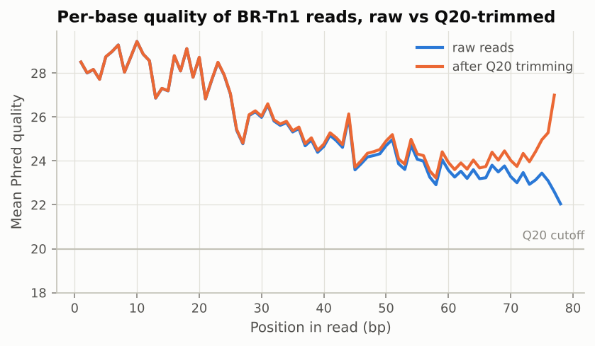
</picture>

FastQC module calls for every library inspected in the course:

| sample | total_sequences | sequence_length | gc_percent | failed_modules |
| --- | --- | --- | --- | --- |
| BR-Tn1_R1 | 5,190 | 78 | 46 | Per base sequence quality, Per base sequence content, Per sequence GC content, Overrepresented sequences, Adapter Content |
| EN59_R1 | 1,479,825 | 35-149 | 50 | Per base sequence content, Per sequence GC content |
| EN59_R2 | 1,479,825 | 35-149 | 50 | Per base sequence content, Per sequence GC content |
| SRR10828193_R1 | 607,820 | 35-251 | 65 |  |
| SRR29263899_R1 | 1,437,637 | 35-149 | 63 | Per base sequence content |
| activity3_reverse | 6,587,331 | 151 | 63 |  |

| sample | layout | reads_or_pairs | adapter | quality_cutoff | min_length | pct_with_adapter | pct_too_short | pct_reads_kept | pct_bp_quality_trimmed | pct_bp_kept |
| --- | --- | --- | --- | --- | --- | --- | --- | --- | --- | --- |
| BR-Tn1 | single | 5,190 |  | 20 | 22 |  | 0.13 | 99.87 | 4.30 | 95.67 |
| Rough_SCFM_3 | single | 1,000,000 | AGATCGGAAGAGCACACGTCTGAACTCCAGTCAC | 20 | 22 | 76.50 | 21.15 | 78.85 | 3.74 | 51.51 |
| SRR10828193 | paired | 607,820 |  | 20 | 22 |  | 0.28 | 99.72 | 2.56 | 97.30 |
| SRR29263899 | paired | 1,437,637 |  | 20 | 22 |  | 0.06 | 99.94 | 0.70 | 99.27 |

## 2. Genome assembly (P. aeruginosa isolates, SPAdes)

Contigs >= 500 bp. Assembly sizes fall inside the 6.32-7.35 Mb range of the 5 complete P. aeruginosa RefSeq genomes downloaded for comparison.

| index | contigs | contigs_ge_1kb | total_length | largest_contig | n50 | l50 | n90 | l90 | gc_percent | n_per_100kb | mean_coverage |
| --- | --- | --- | --- | --- | --- | --- | --- | --- | --- | --- | --- |
| SRR12131093 | 57 | 46 | 6,499,636 | 936,619 | 363,515 | 6 | 106,125 | 19 | 66.32 | 0.00 | 23.00 |
| SRR12131094 | 59 | 48 | 6,499,523 | 849,020 | 301,639 | 7 | 106,125 | 20 | 66.32 | 0.00 | 24.00 |
| SRR12131096 | 62 | 50 | 6,499,789 | 849,020 | 287,290 | 7 | 92,996 | 21 | 66.32 | 0.00 | 19.80 |
| SRR12131097 | 66 | 52 | 6,498,401 | 662,765 | 271,451 | 8 | 92,996 | 22 | 66.32 | 0.00 | 9.60 |

<picture>
  <source media="(prefers-color-scheme: dark)" srcset="figures/dark/assembly_nx_curves.png">
  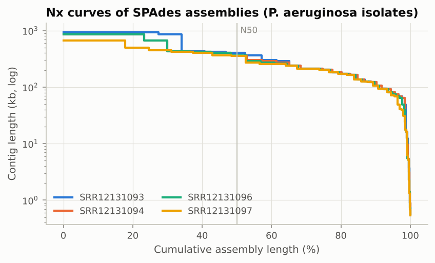
</picture>

Other assemblies from the course (all contigs):

| name | contigs | contigs_ge_1kb | total_length | largest_contig | n50 | l50 | n90 | l90 | gc_percent | n_per_100kb | mean_coverage |
| --- | --- | --- | --- | --- | --- | --- | --- | --- | --- | --- | --- |
| activity6_genome | 1 | 1 | 2,820,462 | 2,820,462 | 2,820,462 | 1 | 2,820,462 | 1 | 32.83 | 0.00 |  |
| outbreak_sample | 42 | 37 | 4,972,383 | 536,032 | 324,586 | 6 | 75,056 | 19 | 52.05 | 0.00 | 60.50 |

## 3. Annotation and marker screening (S. aureus)

| name | genome_length | genes | CDS | pseudogenes | tRNA | rRNA | coding_density_pct | median_cds_length_bp | hypothetical_pct | cds_with_gene_symbol_pct |
| --- | --- | --- | --- | --- | --- | --- | --- | --- | --- | --- |
| NCTC 8325 | 2,821,361 | 2,872 | 2,767 | 30 | 59 | 16 | 83.17 | 720 | 54.10 | 7.90 |
| MRSA107 | 3,095,697 | 3,166 | 2,966 | 121 | 60 | 16 | 82.19 | 720 | 14.90 | 33.30 |
| M48 | 3,050,015 | 3,107 | 2,888 | 140 | 60 | 16 | 81.28 | 724 | 14.50 | 34.00 |
| FDAARGOS_773 | 2,787,057 | 2,770 | 2,626 | 63 | 59 | 19 | 82.85 | 762 | 11.10 | 36.40 |
| 0073_III_ST239 | 3,097,524 | 3,154 | 2,965 | 113 | 57 | 16 | 82.26 | 720 | 14.60 | 33.40 |
| HU-14 | 2,972,382 | 3,022 | 2,851 | 90 | 59 | 19 | 82.92 | 744 | 12.20 | 33.90 |
| Activity 6 genome (BV-BRC) | 2,820,462 | 2,697 | 2,617 | 0 | 61 | 19 | 83.57 | 771 | 19.80 | 0.00 |

methicillin resistance (`mecA` encoding PBP2a) is present in: MRSA107, M48, 0073_III_ST239, HU-14, Activity 6 genome (BV-BRC); absent in: NCTC 8325, FDAARGOS_773.

<picture>
  <source media="(prefers-color-scheme: dark)" srcset="figures/dark/annotation_markers.png">
  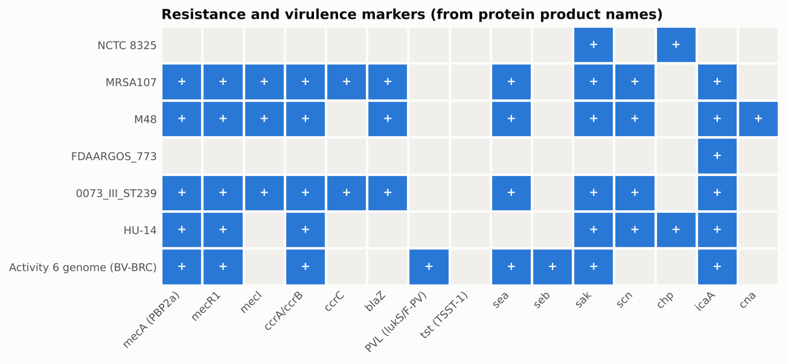
</picture>

Why markers are called from product names, not gene symbols - RefSeq reuses symbols for unrelated genes:

| symbol | product | genomes |
| --- | --- | --- |
| mecA | PBP2a family beta-lactam-resistant peptidoglycan transpeptidase MecA | 4 |
| mecA | adaptor protein MecA | 5 |
| msrA | peptide-methionine (S)-S-oxide reductase MsrA | 5 |

## 4. Pangenome (Roary, 4 clinical isolates + PA14)

| partition | clusters | pct |
| --- | --- | --- |
| core | 5,874 | 98.92 |
| soft_core | 0 | 0.00 |
| shell | 64 | 1.08 |
| cloud | 0 | 0.00 |
| total | 5,938 | 100.00 |

5,938 gene clusters across 5 genomes; only 64 are accessory. Accessory-gene Jaccard distances among the clinical isolates range 0.19-0.55, versus >= 0.87 to PA14.

<picture>
  <source media="(prefers-color-scheme: dark)" srcset="figures/dark/pangenome_rarefaction.png">
  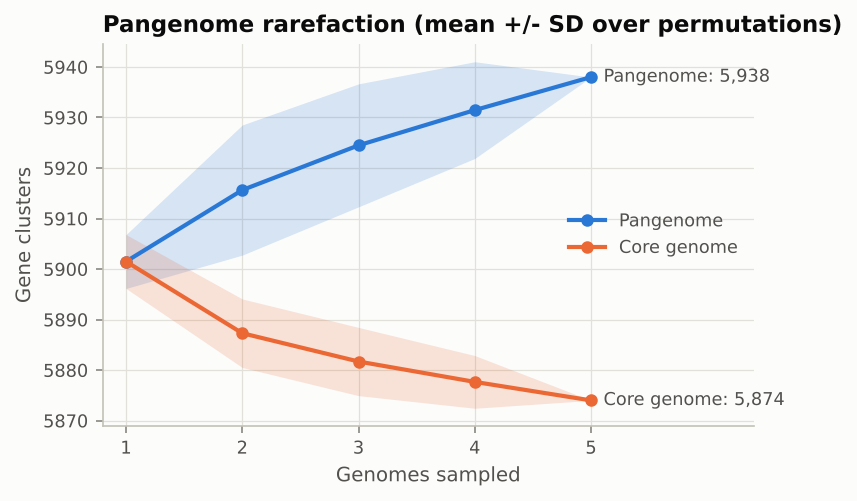
</picture>

<picture>
  <source media="(prefers-color-scheme: dark)" srcset="figures/dark/pangenome_accessory.png">
  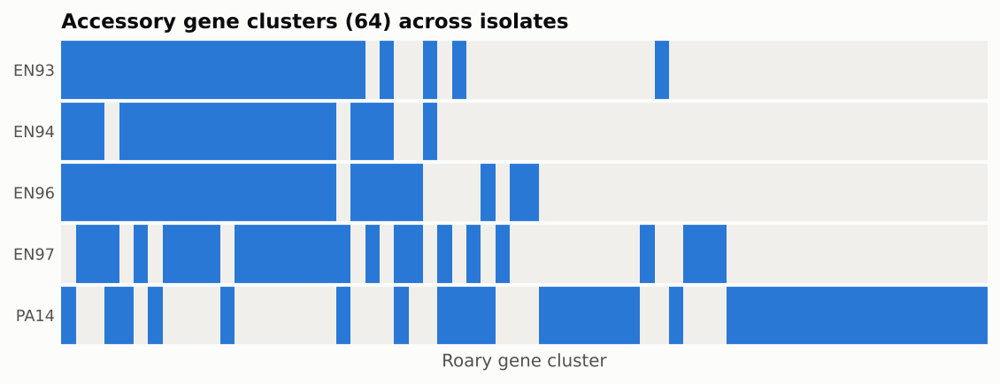
</picture>

## 5. RNA-seq differential expression

Thresholds: BH-adjusted p < 0.05 and |log2FC| >= 1.0. PyDESeq2 is run on the same featureCounts tables used in Galaxy and compared with the Galaxy (R) DESeq2 output.

### M. abscessus ATCC 19977: condition vs wild-type rough

| sample | condition | galaxy_label | assigned_reads | genes_detected | size_factor | rRNA_pct | top_feature |
| --- | --- | --- | --- | --- | --- | --- | --- |
| SRX21222771 | condition | 71 | 35,012,700 | 4,903 | 0.66 | 66.62 | MAB_RS07515 (23S ribosomal RNA) |
| SRX21222772 | condition | 72 | 36,802,646 | 4,921 | 0.85 | 68.12 | MAB_RS07515 (23S ribosomal RNA) |
| SRX21222773 | condition | 73 | 37,265,939 | 4,925 | 0.95 | 65.91 | MAB_RS07515 (23S ribosomal RNA) |
| SRX21222774 | WT_rough | 74 WT R | 34,802,401 | 4,954 | 1.38 | 46.03 | MAB_RS07515 (23S ribosomal RNA) |
| SRX21222775 | WT_rough | 75 WT R | 39,198,010 | 4,951 | 1.55 | 54.10 | MAB_RS07515 (23S ribosomal RNA) |
| SRX21222776 | WT_rough | 76 WT R | 34,640,384 | 4,909 | 0.88 | 66.19 | MAB_RS07515 (23S ribosomal RNA) |

| metric | value |
| --- | --- |
| genes_compared | 5,013 |
| basemean_pearson | 1 |
| lfc_pearson | 0.978 |
| lfc_max_abs_diff | 3.0364 |
| lfc_pearson_tested_genes | 0.99013 |
| lfc_magnitude_ratio_ref_over_ours | 0.838 |
| neglog10p_spearman | 0.99996 |
| padj_na_ours | 240 |
| padj_na_reference | 45 |
| significant_ours | 216 |
| significant_reference | 205 |
| significant_both | 204 |
| jaccard | 0.9401 |
| sign_agreement_pct | 100 |
| size_factor_max_abs_diff_vs_pydeseq2 | 0 |
| normalized_counts_max_rel_diff_vs_galaxy | 6.13084e-15 |

145 genes up and 71 down in `condition` relative to `WT_rough`. Top hits:

| gene_id | gene | product | baseMean | log2FoldChange | padj |
| --- | --- | --- | --- | --- | --- |
| MAB_RS10430 |  | MFS transporter | 15,480 | 4.79 | 7.66e-104 |
| MAB_RS01220 |  | DUF3592 domain-containing protein | 2,650 | 4.54 | 1.08e-88 |
| MAB_RS04360 |  | alkene reductase | 40,568 | 6.39 | 4.58e-81 |
| MAB_RS10425 |  | RND family transporter | 5,293 | 3.95 | 2.26e-76 |
| MAB_RS22620 |  | YbaB/EbfC family nucleoid-associated protein | 2,552 | 3.4 | 1.25e-75 |
| MAB_RS08025 |  | tRNA-Arg | 6,440 | 5.92 | 1.31e-72 |
| MAB_RS07970 | stf0 | trehalose 2-sulfotransferase | 873 | 4.8 | 1.53e-64 |
| MAB_RS22615 |  | HEAT repeat domain-containing protein | 5,897 | 3.77 | 1.1e-63 |
| MAB_RS04495 |  | FAD-dependent monooxygenase | 3,054 | 4.27 | 2.26e-62 |
| MAB_RS08020 |  | hypothetical protein | 60,020 | 5.65 | 1.91e-53 |

<picture>
  <source media="(prefers-color-scheme: dark)" srcset="figures/dark/rnaseq_mabs_volcano.png">
  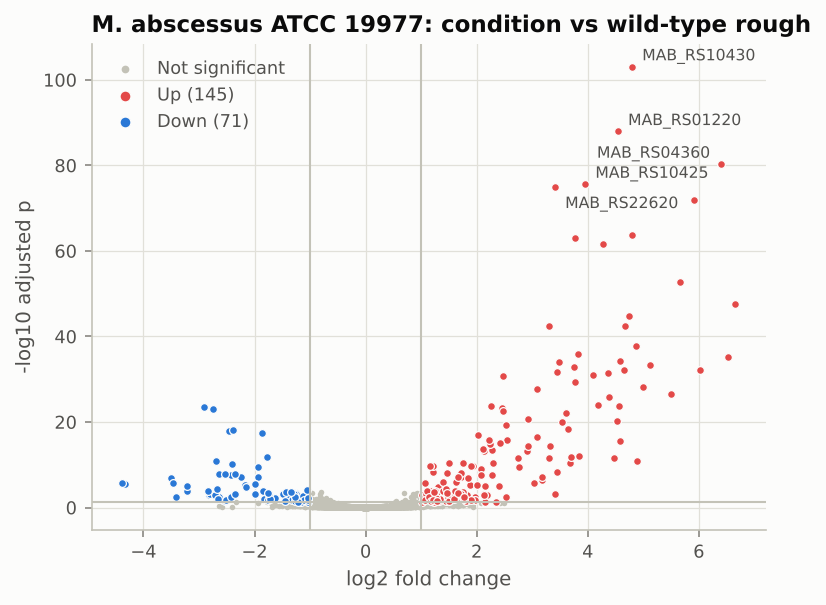
</picture>
<picture>
  <source media="(prefers-color-scheme: dark)" srcset="figures/dark/rnaseq_mabs_concordance.png">
  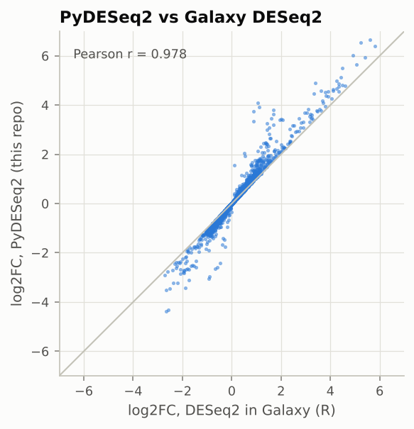
</picture>
<picture>
  <source media="(prefers-color-scheme: dark)" srcset="figures/dark/rnaseq_mabs_pca.png">
  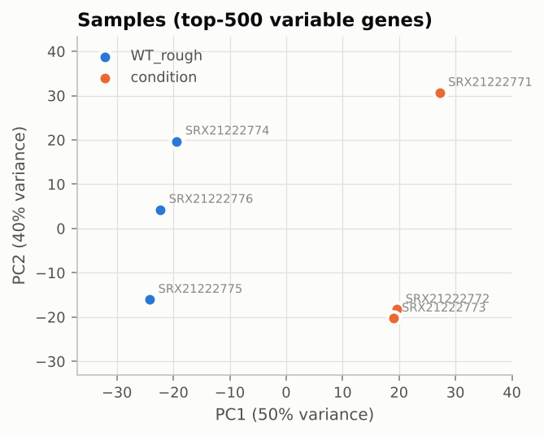
</picture>

### M. tuberculosis H37Rv: experimental vs control

| sample | condition | assigned_reads | genes_detected | size_factor | rRNA_pct | top_feature |
| --- | --- | --- | --- | --- | --- | --- |
| SRX3686749 | control | 9,794,918 | 3,961 | 1.00 | 2.21 | RVnc0046 (10Sa RNA) |
| SRX3686750 | control | 9,029,392 | 3,963 | 0.98 | 1.94 | RVnc0046 (10Sa RNA) |
| SRX3686751 | control | 10,405,376 | 3,964 | 1.03 | 6.73 | RVnc0046 (10Sa RNA) |
| SRX3686752 | experimental | 8,510,657 | 3,956 | 0.80 | 2.18 | RVnc0046 (10Sa RNA) |
| SRX3686753 | experimental | 8,756,647 | 3,958 | 0.85 | 1.78 | RVnc0046 (10Sa RNA) |
| SRX3686754 | experimental | 14,823,834 | 3,965 | 1.44 | 2.14 | RVnc0046 (10Sa RNA) |

| metric | value |
| --- | --- |
| genes_compared | 3,978 |
| basemean_pearson | 1 |
| lfc_pearson | 0.99789 |
| lfc_max_abs_diff | 0.7606 |
| lfc_pearson_tested_genes | 0.99789 |
| lfc_magnitude_ratio_ref_over_ours | 0.984 |
| neglog10p_spearman | 0.99995 |
| padj_na_ours | 10 |
| padj_na_reference | 10 |
| significant_ours | 125 |
| significant_reference | 114 |
| significant_both | 114 |
| jaccard | 0.912 |
| sign_agreement_pct | 100 |
| size_factor_max_abs_diff_vs_pydeseq2 | 0 |

109 genes up and 16 down in `experimental` relative to `control`. Top hits:

| gene_id | gene | product | baseMean | log2FoldChange | padj |
| --- | --- | --- | --- | --- | --- |
| Rv0077c |  | oxidoreductase | 16,434 | 5.82 | < 1e-300 |
| Rv0076c |  | membrane protein | 3,576 | 3.22 | < 1e-300 |
| Rv0341 | iniB | isoniazid inducible protein IniB | 27,080 | 2.66 | < 1e-300 |
| Rv1772 |  | hypothetical protein | 4,433 | 2.33 | < 1e-300 |
| Rv0342 | iniA | isoniazid inductible protein IniA | 7,148 | 2.12 | 5.43e-271 |
| Rv1773c |  | transcriptional regulator | 2,565 | 2.39 | 1.67e-261 |
| Rv0950c |  | hypothetical protein | 3,271 | -1.8 | 2.28e-209 |
| Rv3161c |  | dioxygenase | 2,598 | 2.41 | 3.26e-162 |
| Rv1435c |  | hypothetical protein | 3,153 | 1.66 | 6.63e-158 |
| Rv0251c | hsp | heat shock protein | 3,500 | 2.7 | 2.78e-155 |

<picture>
  <source media="(prefers-color-scheme: dark)" srcset="figures/dark/rnaseq_mtb_volcano.png">
  
</picture>
<picture>
  <source media="(prefers-color-scheme: dark)" srcset="figures/dark/rnaseq_mtb_concordance.png">
  
</picture>
<picture>
  <source media="(prefers-color-scheme: dark)" srcset="figures/dark/rnaseq_mtb_pca.png">
  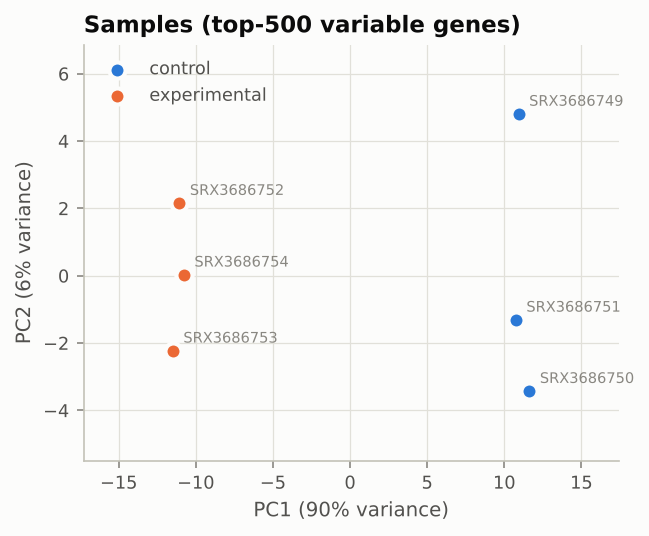
</picture>

## 6. Protein structure

**AlphaFold 3 model of M. tuberculosis Zur/FurB (Rv2359, 130 aa).** Mean pLDDT 88.75; 94% of residues >= 70; mean PAE 5.89 Angstrom.

| model | ranking_score | ptm | iptm | fraction_disordered | has_clash | num_recycles |
| --- | --- | --- | --- | --- | --- | --- |
| 0 | 0.81 | 0.75 | None | 0.12 | no | 10 |
| 1 | 0.79 | 0.75 | None | 0.07 | no | 10 |
| 2 | 0.77 | 0.75 | None | 0.05 | no | 10 |
| 3 | 0.77 | 0.75 | None | 0.03 | no | 10 |
| 4 | 0.77 | 0.75 | None | 0.04 | no | 10 |

> AlphaFold Server output and the figure derived from it are provided under and subject to the [AlphaFold Server Output Terms of Use](https://alphafoldserver.com/output-terms) (non-commercial use; see `data/structure/alphafold3_zur_Rv2359/TERMS_OF_USE.md`).

<picture>
  <source media="(prefers-color-scheme: dark)" srcset="figures/dark/structure_af3_confidence.png">
  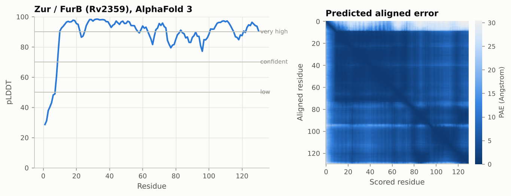
</picture>

**M. abscessus LuxR-family regulator vs M. tuberculosis DosR (AlphaFold DB models).**

| metric | value |
| --- | --- |
| modelled_a | 216 |
| modelled_b | 217 |
| aligned_pairs | 216 |
| identity_pct | 70.4 |
| substitutions | 64 |
| deletions | 0 |
| rmsd_all_ca | 14.38 |
| rmsd_core_ca | 0.61 |
| core_pairs | 132 |
| rmsd_ca_plddt70 | 13.41 |
| pairs_plddt70 | 168 |

Rigid bodies found by iterative superposition (2 Angstrom cutoff):

| body | pairs | rmsd_ca | first_residue | last_residue | median_residue |
| --- | --- | --- | --- | --- | --- |
| 1 | 132 | 0.61 | 1 | 133 | 66 |
| 2 | 68 | 0.46 | 144 | 211 | 177 |

<picture>
  <source media="(prefers-color-scheme: dark)" srcset="figures/dark/structure_dosr_plddt.png">
  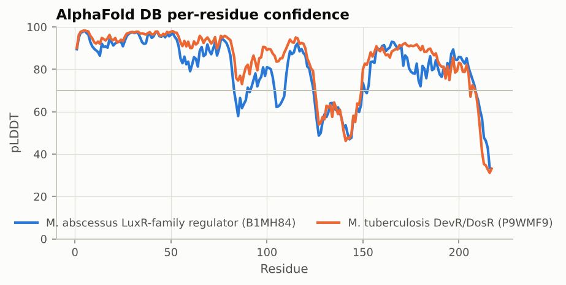
</picture>

**SARS-CoV-2 spike, 6VXX (Wuhan-Hu-1 spike, closed) vs 9F9Y (BA.2.87.1 spike) (chain A).**

| metric | value |
| --- | --- |
| modelled_a | 972 |
| modelled_b | 1,026 |
| aligned_pairs | 956 |
| identity_pct | 96.9 |
| substitutions | 30 |
| deletions | 9 |
| rmsd_all_ca | 1.68 |
| rmsd_core_ca | 0.94 |
| core_pairs | 759 |

Differences at residues modelled in 6VXX (Wuhan numbering); receptor-binding domain (319-541): G339D, S371F, S373P, S375F, T376A, D405N, R408S, K417T, N440K, K444N, L452M, Q498R, N501Y, Y505H. Full list: `results/structure_spike_differences.tsv`. Both entries are engineered ectodomain constructs, so differences can include construct design as well as lineage mutations.

